# 3 · Rancangan Database (PostgreSQL)

Skema ada di `database/migrations/` (3 berkas + tabel pengguna). Konvensi: nama tabel jamak berbahasa Inggris seperti blueprint;
nilai uang `bigint` (rupiah bulat); status berupa string kode; seluruh relasi memakai foreign key.

## 3.1 ERD ringkas

```mermaid
erDiagram
    organizations ||--o{ users : "anggota"
    roles ||--o{ user_roles : ""
    users ||--o{ user_roles : ""
    recipient_categories ||--o{ organizations : "kategori"
    fiscal_years ||--o{ grant_applications : ""
    grant_types ||--o{ grant_applications : ""
    organizations ||--o{ grant_applications : "pemohon / OPD"
    regulations ||--o{ grant_applications : "dasar hukum"
    grant_applications ||--o{ application_budget_items : "RAB"
    grant_applications ||--o{ application_documents : "dokumen berversi"
    document_requirements ||--o{ application_documents : ""
    grant_applications ||--o{ verifications : "adm / teknis"
    grant_applications ||--|| recommendations : ""
    grant_applications ||--|| tapd_reviews : ""
    grant_applications ||--|| decisions : ""
    decrees ||--o{ decisions : "Keputusan Bupati"
    budget_ceilings ||--o{ budget_allocations : "pagu OPD"
    grant_applications ||--|| budget_allocations : ""
    grant_applications ||--o{ nphd_documents : "versi"
    grant_applications ||--o{ disbursements : "tahap 1/2"
    grant_applications ||--o| goods_deliveries : "hibah barang"
    goods_deliveries ||--o{ goods_delivery_items : ""
    grant_applications ||--o{ accountability_reports : "TAHAP_1 / AKHIR"
    accountability_reports ||--o{ report_expenses : ""
    grant_applications ||--o{ fund_returns : "setoran sisa"
    grant_applications ||--o{ warning_letters : ""
    grant_applications ||--o{ monitoring_records : ""
    grant_applications ||--o{ status_histories : ""
    grant_applications ||--o{ data_corrections : ""
    users ||--o{ audit_logs : "tanpa FK (append-only)"
```

## 3.2 Daftar tabel

| Kelompok | Tabel | Catatan |
|---|---|---|
| Pengguna & master | `users`, `roles`, `user_roles`, `organizations`, `recipient_categories`, `fiscal_years`, `grant_types`, `regulations`, `document_requirements`, `settings`, `budget_ceilings` | `users.account_status` = PENDING/ACTIVE/SUSPENDED/REJECTED; `fiscal_years.last_seq` = penomoran register |
| Inti | `grant_applications` ★ | pusat relasi; `lock_version` untuk penguncian optimistis |
| Pendukung usulan | `application_budget_items`, `application_documents` | dokumen: versi, hash SHA-256, masa berlaku, hasil pemeriksaan |
| Penilaian | `verifications`, `recommendations`, `tapd_reviews` | skor teknis + checklist (JSON) |
| Penetapan & anggaran | `decrees`, `decisions`, `budget_allocations`, `nphd_documents` | alokasi `RESERVED → CONFIRMED / RELEASED` |
| Penyaluran | `disbursements`, `goods_deliveries`, `goods_delivery_items` | `idempotency_key` unik |
| Pertanggungjawaban | `accountability_reports`, `report_expenses`, `fund_returns`, `warning_letters`, `monitoring_records` | |
| Kontrol | `status_histories`, `audit_logs`, `data_corrections`, `notifications`, `backup_logs` | |
| Infrastruktur | `sessions`, `password_reset_tokens` | |

Total **36 tabel**. Tabel pada blueprint (`users, roles, user_roles, organizations, fiscal_years, grant_types, audit_logs, grant_applications,
application_documents, verifications, recommendations, decisions, budget_allocations, nphd_documents, disbursements, goods_deliveries,
accountability_reports, monitoring_records`) semuanya ada.

## 3.3 Kamus data — `grant_applications`

| Kolom | Tipe | Keterangan |
|---|---|---|
| `reg_number` | varchar(40) unik | `EH/{tahun}/{kode OPD}/{urut}` dibuat saat diajukan |
| `fiscal_year_id`, `applicant_org_id`, `opd_id`, `grant_type_id`, `recipient_category_id`, `regulation_id` | FK | |
| `title, background, purpose, target, program_activity, location` | teks | isi usulan (Pasal 6) |
| `activity_start/end`, `activity_completed_at`, `lpj_due_date` | date | dasar tenggat LPJ |
| `committee` | text (JSON) | susunan panitia |
| `is_recurring`, `recurring_reason`, `funding_declaration` | | Pasal 2 & 4 |
| `amount_requested / recommended / approved` | bigint | rupiah |
| `status` | varchar(14) | lihat [05-WORKFLOW-SOP](05-WORKFLOW-SOP.md) |
| `revision_no` | smallint | bertambah tiap pengajuan ulang setelah RETURNED |
| `disbursement_scheme` | `STAGED` / `FULL` | `FULL` hanya via otorisasi BPKAD |
| `lpj_overdue`, `bpk_audit_date` | | tunggakan; khusus parpol |
| `lock_version` | int | formulir menyertakan versi; beda versi → ditolak |

## 3.4 Integritas yang ditegakkan di database

| Mekanisme | Tujuan |
|---|---|
| FK ke seluruh relasi; `cascade` hanya dari `grant_applications` ke catatan prosesnya | konsistensi |
| `audit_logs`: trigger `BEFORE UPDATE OR DELETE` + `BEFORE TRUNCATE` (PostgreSQL), trigger SQLite setara | log tak dapat diubah siapa pun, termasuk pemilik aplikasi |
| `audit_logs.user_id` **tanpa FK** | agar penghapusan pengguna tidak memicu `UPDATE … SET NULL` yang ditolak trigger |
| `audit_logs.old_values/new_values` bertipe **text** | rantai hash dihitung ulang persis (jsonb mengurutkan ulang kunci) |
| Indeks unik parsial `app_doc_current_unique` | satu dokumen *current* per jenis; versi lama = riwayat |
| Indeks unik parsial `disb_active_stage_unique` | satu penyaluran aktif per tahap |
| `disbursements.idempotency_key` UNIQUE | retry/klik ganda tidak menggandakan pembayaran |
| `budget_ceilings` UNIQUE(`fiscal_year_id`,`opd_id`) + `lockForUpdate` saat alokasi | alokasi paralel tak dapat melampaui pagu |
| `application_documents` UNIQUE(app, tipe, relasi, versi) | versi tidak tertimpa |

## 3.5 Retensi & arsip

Retensi backup (`backup.retention_days`, bawaan 30 hari) dapat diubah di *Konfigurasi*. Retensi audit trail ditetapkan sebagai kebijakan (tidak ada penghapusan otomatis; log append-only). Data permohonan **tidak dihapus** — usulan yang
dibatalkan/ditolak tetap tersimpan sebagai arsip. Penghapusan pengguna tidak didukung (gunakan *tangguhkan*).
