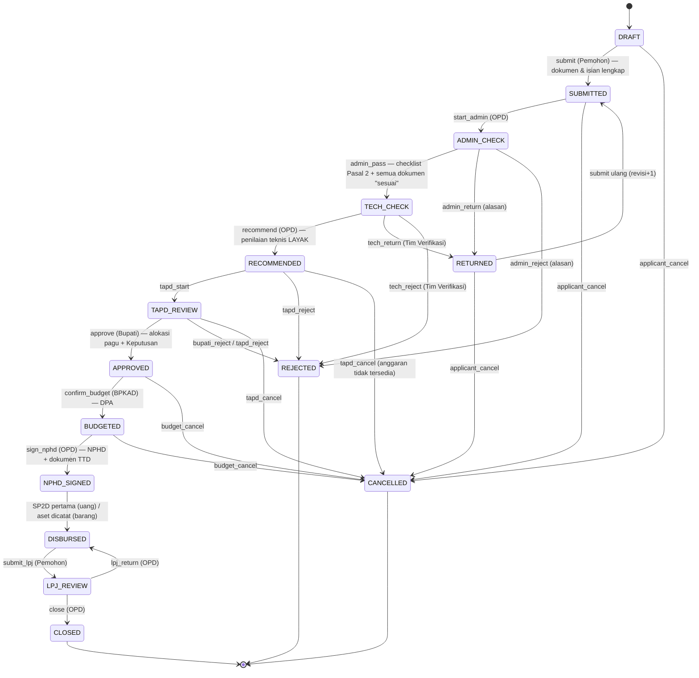
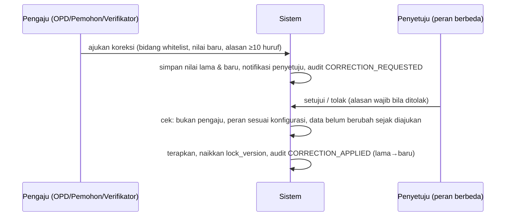

# 5 · Workflow, SOP, Penolakan & Koreksi Data

## 5.1 Diagram status

## 5.2 SOP → transisi → penanggung jawab → keluaran (Blueprint Bab 4)

| SOP | Fase | Prosedur | Aksi sistem | Peran | Keluaran |
|---|---|---|---|---|---|
| 1 | Pengajuan | Registrasi & validasi akun | `/daftar` → `admin.users.validate` | Pemohon → Admin Sistem (admin layanan) | Akun aktif |
| 2 | Pengajuan | Pengajuan usulan | `submit` | Pemohon | Formulir usulan + no. register |
| 3 | Penilaian | Pemeriksaan kelengkapan | `start_admin`, periksa dokumen, `admin_pass` | OPD | Checklist kelengkapan |
| 4 | Penilaian | Verifikasi teknis & substantif | `recordTechnical` (skor 4 kriteria), berita acara PDF | Tim Verifikasi | Berita acara |
| 5 | Penilaian | Rekomendasi hibah | `recommend` | OPD | Surat rekomendasi (Lampiran A) |
| 6 | Penetapan | Pertimbangan & penetapan | `tapd_start`, `recordTapdReview`, `approve` | TAPD & Bupati | Keputusan Bupati |
| 7 | Penetapan | Sinkronisasi anggaran | alokasi pagu + `confirm_budget` | OPD / BPKAD | Data alokasi (DPA) |
| 8 | Penetapan | Penyusunan & penandatanganan NPHD | `draftNphd`, unggah NPHD_TTD, `sign_nphd` | OPD & penerima | NPHD final |
| 9 | Penyaluran | Pengajuan & penyaluran hibah **uang** | `DisbursementService::request/process` | OPD, BUD/BPKAD | SP2D & bukti transfer |
| 10 | Penyaluran | Penyerahan hibah **barang** | `GoodsService` | OPD & penerima, BPKAD | BAST & daftar barang |
| 11 | Pertanggungjawaban | Pelaporan penggunaan | `AccountabilityService::saveDraft`, `submit_lpj` | Pemohon | Laporan & bukti |
| 12 | Pertanggungjawaban | Pemeriksaan LPJ | `lpj_return` / `close` | OPD | Hasil pemeriksaan |
| 13 | Pertanggungjawaban | Pengembalian sisa dana | `recordReturn` | Penerima & pihak terkait | Bukti setoran |
| 14 | Pertanggungjawaban | Monitoring & evaluasi | `recordMonitoring` | OPD & Inspektorat | Laporan & tindak lanjut |
| 15 | Pertanggungjawaban | Pengarsipan & penutupan | guard `close` → `CLOSED` | Pengelola hibah (OPD) | Arsip lengkap |

Aturan alur (Blueprint Bab 4): SOP 9 hanya hibah uang, SOP 10 hanya hibah barang — **sistem memilih jalur otomatis** dari `grant_types.form`
dan menolak hibah barang di jalur pencairan uang (UAT Blueprint-10).

## 5.3 Guard (prasyarat) per aksi

| Aksi | Prasyarat yang diperiksa server |
|---|---|
| `submit` | Isian wajib (judul, latar belakang, maksud, sasaran, program, lokasi, tanggal) · panitia ≥ 1 · RAB ≥ 1 baris & total = nilai usulan · pernyataan non-ganda · alasan bila berulang · jenis = hibah aktif (bukan bansos) · **regulasi aktif** · TA berjalan & dalam masa pengajuan · kategori usulan = kategori lembaga · rekening (uang) · ketua+sekretaris (parpol) · **semua dokumen wajib** terunggah & berlaku |
| `admin_pass` | Setiap dokumen wajib berstatus **sesuai** · 6 kriteria Pasal 2 dicentang (jika tidak: kembalikan/tolak) |
| `recommend` | Verifikasi administrasi lulus pada putaran berjalan · kriteria lengkap · peruntukan spesifik terisi · **verifikasi teknis LAYAK** (skor ≥ ambang) · nilai rekomendasi ≤ nilai usulan |
| `approve` | Pertimbangan TAPD ada · **alokasi pagu ada** · Keputusan Bupati memuat nomor, tanggal, ref Perda & Perkada dan sama tahun anggaran · nilai ≤ rekomendasi & ≤ alokasi |
| `confirm_budget` | Alokasi masih aktif · kode rekening & ref DPA terisi |
| `sign_nphd` | NPHD ada · nilai = nilai ditetapkan · penandatangan = Kepala OPD pemilik urusan · dokumen NPHD bertanda tangan terunggah |
| penyaluran uang | NPHD ditandatangani · dokumen pencairan lengkap · satu pengajuan aktif per tahap · total ≤ NPHD · **tahap II: tahap I tersalur & laporan tahap I diterima** · kunci idempotensi |
| penyerahan barang | Data pengadaan + daftar barang · BAST & pakta C.2 terunggah · aset dicatat BPKAD |
| `submit_lpj` | Dana tersalur penuh (uang) / aset tercatat (barang) · tanggal selesai kegiatan · uraian & hasil · realisasi ≤ tersalur · rincian realisasi · dokumen LPJ wajib · tgl pemeriksaan BPK (parpol) |
| `close` | Dokumen LPJ dinyatakan sesuai · **sisa dana disetor penuh + bukti** · bukti transfer RKUD lengkap / BAST ada · ≥ 1 monev & tak ada tindak lanjut terbuka |

Pesan "prasyarat belum terpenuhi" ditampilkan ke pengguna di panel *Tindakan* (UI Blueprint: "tombol tidak tersedia / ditolak").

## 5.4 Skenario penolakan

| Skenario | Status akhir | Aturan |
|---|---|---|
| Dokumen/isian kurang (OPD atau Tim Verifikasi) | `RETURNED` | alasan **wajib**; pemohon memperbaiki; unggah versi baru (versi lama tersimpan); `submit` ulang → `revision_no`+1 dan verifikasi dimulai putaran baru |
| Tidak memenuhi syarat / tidak layak | `REJECTED` | alasan **wajib**; status akhir; alokasi pagu (bila ada) **dikembalikan ke pagu**; notifikasi ke pemohon & OPD; pemohon dapat mengajukan usulan baru |
| Ditolak Bupati / TAPD | `REJECTED` | sama; riwayat & alasan tersimpan |
| Anggaran tidak tersedia / dicabut sebelum NPHD | `CANCELLED` | alasan wajib; pagu dikembalikan |
| Dibatalkan pemohon (sebelum diperiksa) | `CANCELLED` | hanya `DRAFT/SUBMITTED/RETURNED` |
| Pencairan ditolak BPKAD | penyaluran `DITOLAK` | alasan wajib; OPD dapat mengajukan ulang (kunci idempotensi baru) |
| LPJ tidak lengkap | kembali `DISBURSED`, laporan `PERLU_PERBAIKAN` | catatan kekurangan tersimpan; pemohon memperbaiki & mengajukan ulang |
| Laporan tahap I perlu perbaikan | laporan `PERLU_PERBAIKAN` | tahap II tetap terkunci |
| Pengecualian 100% ditolak | skema tetap 70/30 | OPD tidak berwenang otorisasi; hanya BPKAD |

Status akhir (`CLOSED/REJECTED/CANCELLED`) tidak memiliki aksi lanjutan (diuji).

## 5.5 Koreksi data

| Aturan | Rincian |
|---|---|
| Bidang yang dapat dikoreksi | judul, maksud, sasaran, lokasi, tanggal kegiatan (usulan); nomor/tanggal NPHD; nomor SPP/SPM/SP2D, tanggal SP2D, bukti RKUD, rekening (penyaluran); nomor/tanggal Keputusan — `config/ehibah.php → corrections` |
| **Nilai uang tidak dapat dikoreksi** | agar pagu, NPHD, dan penyaluran tetap konsisten → batalkan & ajukan ulang |
| 4-mata | penyetuju ≠ pengaju; peran penyetuju per bidang (mis. nomor SP2D → hanya BPKAD) |
| Konflik perubahan | bila nilai berubah sejak diajukan, penerapan ditolak (hindari menimpa perubahan lain) |
| Jejak | koreksi menyimpan nilai lama/baru, alasan, pengaju, penyetuju, waktu; audit trail mencatat kedua langkah |
| Sebelum pengajuan | Pemohon mengedit bebas pada `DRAFT/RETURNED` (tanpa koreksi); setelah itu terkunci |

## 5.6 Konkurensi & integritas

- Setiap transisi berjalan dalam **satu transaksi** dengan `SELECT … FOR UPDATE` pada baris usulan.
- Formulir membawa `lock_version`; bila pengguna lain sudah mengubah usulan, aksi ditolak ("Data telah diubah pengguna lain").
- Notifikasi dikirim **setelah** commit sehingga tidak ada pemberitahuan atas transaksi yang dibatalkan.
